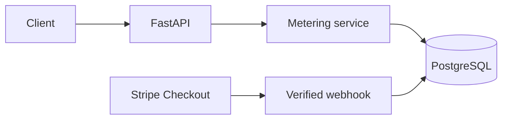

# Design — LLM Usage Metering & Billing Engine

## Problem, scope, and boundary

The service records a tenant's billable API and simulated AI-token usage, enforces monthly limits, calculates cost, and mirrors Stripe **test-mode** subscription state. Core scope is two plans, two usage types, and one billable `POST /generate`. **Non-goal:** invoicing, proration, and overage billing. No model call is needed.

## Data, identity, and period

Migrations will create `tenants`, `api_keys`, `plans`, `subscriptions`, `usage_events`, `stripe_events`, and a tenant-month quota-state/rollup row. Tenant-owned records carry `tenant_id`; repositories always scope queries by it. An API key is supplied in a request header, looked up by a secure one-way hash, and resolves the tenant; clients never supply `tenant_id`. Bootstrap/demo keys are generated once, shown only through a secure documented local setup step, and only their hashes are persisted or logged.

**Initial subscription lifecycle:** A tenant created through the local bootstrap script receives the Free plan with an `active` local subscription so that local development and testing can begin immediately. A paid plan upgrade must be confirmed by a verified Stripe webhook; an unverified client request must never activate a paid plan. If a subscription becomes inactive or unpaid, billable requests return HTTP `402 Payment Required`. Exceeding an otherwise active plan's monthly quota returns HTTP `429 Too Many Requests`. Stripe event processing must account for duplicate and out-of-order events before updating local subscription state.

`usage_events` records the UTC calendar month, API-call quantity, token breakdown, payload fingerprint, idempotency key, response snapshot, and integer cost. The usage window is `[first day of UTC month, first day of next UTC month)` for both writes and rollups. Constraints include unique `(tenant_id, idempotency_key)` and unique Stripe event ID.

## Plans, API, and layers

Free is **1,000 API calls/month** and **100,000 AI tokens/month**. Project decisions (not FlyRank rates): Pro is **100,000 API calls/month** and **10,000,000 AI tokens/month**; these values must appear in `README.md` before release. `POST /generate` accepts validated simulated counts plus `Idempotency-Key`; `GET /usage` returns the current UTC-month usage, limits, and costs; `POST /checkout` starts a Stripe subscription Checkout.

FastAPI owns authentication and boundary validation; services own quota, meter, pricing, and subscription rules; repositories own SQL; Stripe and alerting are adapters. Bad input is a clean 4xx. Both API-call (+1) and token quotas are checked before the billable action. A request that reaches a limit exactly succeeds; one that would exceed it is `429 Too Many Requests`, with used/limit/requested detail and period-end `Retry-After`. `402 Payment Required` is distinct: the subscription is inactive/unpaid or payment/upgrade is required, not merely usage exhausted.

## Token accounting and cost

`input_tokens` **includes** `cached_input_tokens`; validation requires `0 <= cached_input_tokens <= input_tokens`. `output_tokens` **includes** `reasoning_tokens`; validation requires `0 <= reasoning_tokens <= output_tokens`. Token quota consumption is `input_tokens + output_tokens`, so every token counts once. Fresh input is `input_tokens - cached_input_tokens`; price it at the input rate, cached input at the cached-input rate, and all `output_tokens` at the output rate. Reasoning is output-priced and is never added/charged again.

All pricing rates are integer micro-units per 1,000,000 tokens. `1,000,000` micro-units equals one project-defined billing unit. Versioned, pinned project-defined example constants are: API call = `0` micro-units; fresh input = `1,000,000` micro-units per million tokens; cached input = `250,000` per million; output = `4,000,000` per million. These are example project rates, **not official FlyRank prices and not necessarily euro-denominated prices**; they must be proved in `EVIDENCE.md`. For an event, calculate the integer numerator `(fresh * input_rate) + (cached * cached_rate) + (output * output_rate)`, then apply exactly one integer ceiling division: `ceil_div(numerator, 1_000_000) = (numerator + 1_000_000 - 1) // 1_000_000`. Round once per event, never separately per token category. Stored costs and rollups never use floating-point arithmetic.

## Idempotency, transactions, and concurrency

The service checks for an existing `(tenant, key)` **before** rejecting a retry for exhausted quotas: the same payload fingerprint returns its saved response; a different payload returns `409 Conflict`. For a new key, one PostgreSQL transaction atomically inserts the tenant/month quota-state row if absent using `INSERT ... ON CONFLICT ... DO NOTHING` (or an equivalent upsert), then locks the resulting row with `SELECT ... FOR UPDATE` in that same transaction. This makes concurrent first requests wait on one row rather than bypassing quota enforcement or creating duplicate state rows. The transaction rechecks idempotency after the lock, validates subscription and proposed quotas, writes the event/response and updated state, then commits. Concurrent duplicate inserts meet the unique constraint: PostgreSQL waits as needed for the competing transaction's outcome; safe conflict handling then fetches the committed row and compares its fingerprint, rather than creating another event or treating a conflict as a fresh request. Rejected new requests write no event. The tenant-month lock serializes distinct requests and makes the boundary rule concurrency-safe.

## Stripe and background work

The raw-body webhook verifies the `whsec_` signature before mutations; a forged request is `400`. In one transaction it records/deduplicates the Stripe event ID and handles `checkout.session.completed`, `customer.subscription.updated`, and `customer.subscription.deleted`, synchronizing the tenant's plan/status only from verified events. Stripe delivery order is not assumed. The subscription record stores the last applied event metadata, but an older or equal-timestamp event is not silently allowed to discard a legitimate change: when timestamps are ambiguous, or an event is out of order, retrieve the current Stripe subscription state and apply that verified current state, with a reconciliation path for events that do not contain enough state. Duplicate event IDs remain no-ops. A valid Checkout completion can therefore synchronize Free to Pro, while later verified state changes or documented reconciliation remain authoritative; local state is never changed by an unverified request.

One bounded background job sends a once-per-period 80%-quota alert from an alert-outbox record, outside requests. The alert has a database-unique identity `(tenant_id, billing_month, usage_type, threshold)`, where `threshold` is the 80% threshold, so repeated quota checks use an insert-on-conflict and cannot create duplicate alert records. Delivery attempts are tracked on that one record; retries claim it idempotently, retry transient failures three times with bounded exponential backoff, and persist terminal failure. An adapter delivery identifier or equivalent idempotency key prevents a retried delivery from producing uncontrolled duplicates. The free local adapter emits structured alerts to application logs, and an injectable failing adapter makes retry/terminal-failure behavior testable. This job is independent of the acceptance-critical Checkout-to-Pro webhook path.

## Verification and review

Later pytest/EVIDENCE work will cover the five official Section 12 acceptance criteria:

1. **Idempotency:** Send the same billable request twice using the same idempotency key. Exactly one usage event must exist, and the second response must mirror the first.
2. **Quota boundary:** Drive a tenant to the exact documented quota boundary. Verify the boundary behavior and that the next over-limit request returns HTTP 429 with a clear message. Keep HTTP 402 reserved for the separate payment-required or inactive/unpaid subscription condition.
3. **Stripe Checkout:** Complete Stripe test-mode Checkout, process the verified webhook, confirm that the tenant changes from Free to Pro, and verify that `GET /usage` returns the new limits.
4. **Webhook security and replay:** A forged webhook with an invalid signature returns HTTP 400 and changes nothing. Replaying a valid Stripe event processes it only once.
5. **Pricing:** Verify exact totals from the pinned pricing rules, including cheaper cached input and reasoning tokens priced as output without double-counting. Verify that `GET /usage` reports the expected values.

The broader verification plan also covers tenant isolation, authentication, payload conflicts, concurrent quota boundaries, out-of-order events, and alert retries. These checks do not substitute for the five official probes.

**Implementation status:** The database foundation, initial migration, API-key authentication, plan seeding, local tenant bootstrap, billable generation, usage reporting, Stripe Checkout, verified Stripe subscription synchronization, and threshold alert outbox processing are implemented. Automated tests cover these areas where the PostgreSQL integration fixture is available. The official acceptance checks remain to be completed and documented.

Human review remains needed for the project-selected prices and Pro limits, Stripe retrieval and reconciliation behavior, and secure local bootstrap wording.
